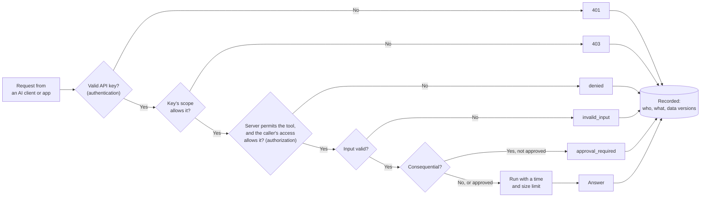

# Tutorial: Quant-Agent-OS for a fund's leadership

This tutorial is for a fund's CEO and CTO, and for the engineer who sits beside them. In about 90
minutes you build an analytical application, let an AI client use it, and then test the controls
that decide who gets in, what each person reaches, and what is recorded. Each lab ends with **what
this shows**, a short summary for anyone who reads along without running the commands. At the end,
[tell us what to improve](#give-feedback).

- **You need:** [uv](https://docs.astral.sh/uv/), a macOS or Linux terminal (on Windows, use WSL
  or Git Bash), and basic Python. Lab 5 can also use Claude Code.
- **You don't need:** an API key or any money, except for Claude Code itself. After setup, only
  Labs 3 to 5 use the network, to download Python packages. All the data is synthetic.
- **Time:** about 90 minutes. Labs 3 to 7 build on each other, so do them in order.

Everything was run on version 0.4.0 on 2026-11-15, and Labs 3 to 7 again on 2026-11-17, except
that Claude Code itself was not run: Lab 5's MCP endpoint was checked with an MCP client instead.
Run ids, keys, and timings will differ, and some outputs are shortened. This is research software, not investment advice.

> **Can't see the diagrams?** GitHub draws them. In VS Code, install the *Markdown Preview
> Mermaid Support* extension.

## What a fund's leadership should know first

Quant-Agent-OS is not a chatbot, and it calls no AI model. It is a server your firm runs, on your
own machines, that offers your own Python tools and data to the AI clients your people already use,
such as Claude, Cursor, or Copilot. The client's model decides which tool to call. Your server
decides whether the call is allowed, runs it, and records it.

So the questions to ask are about the server:

| Question | The answer, in one line | Lab |
| --- | --- | --- |
| Can our team build on it? | A command generates a tested application for a stage of the fund's work. You own its code, and three lines give it to an AI client | [3](#lab-3-generate-a-risk-application), [4](#lab-4-configure-and-customize-it), [5](#lab-5-make-it-usable-by-an-ai-client) |
| **Authentication:** who gets in? | Every network request needs an API key. Keys are stored as hashes, can expire, and are revoked without a restart | [6](#lab-6-authentication-who-gets-in) |
| **Authorization:** who reaches what? | An access file lists each group's tools and datasets, and refuses everything else. A refused dataset looks like one that does not exist | [7](#lab-7-authorization-who-reaches-what) |
| Can an AI do something consequential on its own? | No. The server is read-only by default, and anything more needs a permission the operator grants and a person's approval of each call | [8](#lab-8-permissions-and-approvals) |
| Can we prove what happened? | Every call is recorded under the caller's name, with the data's fingerprints and the tool's version | All |
| Are the numbers right? | Numbers come from your Python code, never from a model, and each states its convention | [1](#lab-1-your-first-report), [2](#lab-2-numbers-by-reference) |

Every request passes these checks, in this order:



Four words recur. **Authentication** is checking who is calling, by API key. **Authorization** is
what that caller may reach: a key's scopes, and the groups in the access file. **Permissions** are
what the server may do at all, such as reading data or calling a network service. An **approval** is
a person saying yes to one specific call.

## Choose your path

| Lab | You will see | Time |
| --- | --- | --- |
| [1. First report](#lab-1-your-first-report) | Numbers with their provenance | 5 min |
| [2. Numbers by reference](#lab-2-numbers-by-reference) | Data that never passes through the model | 5 min |
| [3. Generate a risk application](#lab-3-generate-a-risk-application) | A tested application from one command | 10 min |
| [4. Configure and customize it](#lab-4-configure-and-customize-it) | Your limits, your report, your own rule | 15 min |
| [5. Make it usable by an AI client](#lab-5-make-it-usable-by-an-ai-client) | Your application's tools served to Claude | 15 min |
| [6. Authentication](#lab-6-authentication-who-gets-in) | Keys, scopes, expiry, and revocation | 10 min |
| [7. Authorization](#lab-7-authorization-who-reaches-what) | Groups, refusals, and the auditor's view | 15 min |
| [8. Permissions and approvals](#lab-8-permissions-and-approvals) | Why an AI can't act on its own | 10 min |
| [9. Your research, with citations](#lab-9-optional-your-research-with-citations) | Optional: answers from your documents | 15 min |

A CEO short on time can read [the first section](#what-a-funds-leadership-should-know-first),
the **what this shows** box of each lab, and [before production](#before-production).

## Setup

```bash
git clone https://github.com/yuxuzi/quant-agent-os.git
cd quant-agent-os
uv sync --locked
source examples/tutorial/env.sh
```

If you already have a clone, skip the first line and `cd` into your clone. `env.sh` prints what it
set:

```text
REPO=/Users/you/quant-agent-os  (your clone)
TUT=/Users/you/qaos-tutorial  (everything the tutorial creates; QUANT_AGENT_OS_HOME points here)
In a new terminal, first run: source "/Users/you/quant-agent-os/examples/tutorial/env.sh"
```

The tutorial uses these names in its commands:

| Name | What it is | Why the commands use it |
| --- | --- | --- |
| `$REPO` | Your clone of Quant-Agent-OS | `uv run --project "$REPO" qaos ...` runs the platform's command from any folder, such as the application you generate in Lab 3 |
| `$TUT` | `~/qaos-tutorial` | Everything the tutorial creates: datasets, keys, run records, and the application. `rm -rf "$TUT"` removes it all |
| `QUANT_AGENT_OS_HOME` | The same folder as `$TUT` | Where `qaos` and the server keep data, so your work stays apart from any real Quant-Agent-OS data |
| `call`, `get` | Two small shell functions | Labs 5 to 7 use them to call the server. They work from any folder |

Variables live only in the terminal that set them. **In each new terminal, run the `source` line
that `env.sh` printed.** It works from any folder. Each lab says which folder its commands run in,
and starts with a `cd` to it, so you can begin any lab in a fresh terminal.

```bash
uv run qaos --version
```

```text
qaos 0.4.0
```

---

## Lab 1: Your first report

**Goal:** see one complete cycle, with no AI involved. A script names the tool calls, so the
result is the same every time. In real use, the AI client chooses the calls.

Labs 1 and 2 run in your clone:

```bash
cd "$REPO"
uv run python examples/portfolio-research/portfolio_research.py
```

```text
# Summarize the return and drawdown profile of the synthetic balanced portfolio

## Findings

- **computed**: Annualized return of synthetic-balanced-2025 is 4.82%. [sources: synthetic-balanced-2025 (12 periods)]
- **computed**: Maximum drawdown of synthetic-balanced-2025 is -2.10%. [sources: synthetic-balanced-2025 (12 periods)]

## Warnings

_None._

## Limitations

- Findings are limited to the registered tools and the data supplied for this run.
- This report is research support, not investment advice.

## Provenance

| Step | Tool | Version | Status | ms |
| --- | --- | --- | --- | --- |
| 1 | annualized_return | 1.0.0 | ok | 0.188 |
| 2 | max_drawdown | 1.0.0 | ok | 0.118 |

Run `af9eb90d1b3d4343bbe570f9c17bc83c`: platform 0.4.0, registry `1f84e6bfc1cd`, 2026-11-15T19:10:45.892969+00:00 to 2026-11-15T19:10:45.894957+00:00.
```

To see a refusal, copy the configuration:

```bash
cp examples/portfolio-research/sample_config.toml "$TUT/my_portfolio.toml"
```

Add `"guess_the_future"` to `metrics` in the copy, then run the example on it:

```bash
uv run python examples/portfolio-research/portfolio_research.py "$TUT/my_portfolio.toml"
```

The report gains a warning, `guess_the_future: unknown_tool - Unknown tool 'guess_the_future'...`,
and the other metrics still run.

> **What this shows:** each finding says how it was produced (`computed`) and from what. The
> provenance table names the tool version behind each number, and the run id ties it to the
> record. A call that can't run is refused and reported, and it does not stop the others.

---

## Lab 2: Numbers by reference

**Goal:** compute performance and risk by naming a dataset rather than pasting numbers. An AI client
works the same way, so your returns never pass through the model.

Adding data is a command **you** run. No AI client can call it.

```bash
cd "$REPO"
uv run qaos data add examples/tutorial/data/fund_returns.csv --id fund
uv run qaos data add examples/tutorial/data/portfolio_returns.csv --id portfolio
uv run python examples/tutorial/lab_analytics.py
```

```text
Added dataset fund: 36 rows, columns fund, benchmark (sha256 cab59d43f0a99633).
Its dates show 12 periods per year.
Added dataset portfolio: 36 rows, columns equities, bonds, gold, market, rates (sha256 137459bf5cc09216).
Its dates show 12 periods per year.
Performance of fund.fund over 36 months
  annualized_return    0.1054
  sharpe_ratio         1.1043
  max_drawdown        -0.0803
  beta                 0.8210
  alpha                0.0184
  Sharpe convention: mean excess over sample deviation, times sqrt(periods per year); the annual risk-free rate is divided by periods per year
  Data version: cab59d43f0a99633
  Warnings: none

Risk of 60-30-10: volatility 7.15% a year
  equities  weight  60%  share of risk  88.9%
  bonds     weight  30%  share of risk   6.6%
  gold      weight  10%  share of risk   4.5%
  Factor exposures: {'market': 0.6, 'rates': 0.21}
  The factors explain 77.2% of the variance.
```

The script passed `{"dataset": "fund", "column": "fund"}`, never the values. Labs 5 and 7 use these
two datasets, so keep them.

| Try this | What you should see |
| --- | --- |
| Add a CSV with a text value in a number column | Refused, naming the place: `Dataset 'broken' line 3, column 'fund': 'oops' is not a number or a missing value.` |
| Add only 6 rows as a dataset, then compute on it | `Warnings:` says the results are unreliable below 12 observations |

> **What this shows:** each result states its **convention**, so nobody has to guess how the
> Sharpe ratio was defined, and its **data version**, a fingerprint of the file. Change the data and
> the fingerprint changes. Bad data is refused at the door, and thin data draws a warning rather
> than false confidence.

---

## Lab 3: Generate a risk application

**Goal:** go from one command to a tested risk application that your team owns. App Factory
generates one application for each stage of a fund's work:

| Application | For | Takes | Produces |
| --- | --- | --- | --- |
| `alpha-research` | Quant researchers | Prices, the firm's signal | Information coefficients, decay, spreads; a signal file |
| `strategy-backtest` | Researchers, PMs | Signals or target weights, prices | Net and gross returns, with walk-forward |
| `risk-monitor` | Risk, PMs | Positions, prices | Exposures, value at risk, stress, limit checks |
| `performance-report` | COO, investor relations | Returns | Horizon tables, tear sheets, Excel, reconciliation |

This lab builds a `risk-monitor`, with the `agent-tools` component that Lab 5 uses to serve it to
an AI client. Write the application's spec:

```bash
mkdir -p "$TUT/work" && cd "$TUT/work"
cat > desk-risk.toml <<EOF
name = "desk-risk"
template = "quant-apps"
profile = "risk-monitor"
description = "Risk limits and stress for our book"
output_dir = "$TUT/work"
components = ["agent-tools"]
quant_agent_os_source = "$REPO"
EOF
```

`quant_agent_os_source` points the application at your clone. A real project leaves it out, and
gets the released platform from GitHub. You are now in `$TUT/work`, outside your clone, so
`--project "$REPO"` tells uv to run the platform's `qaos` from your clone. Preview the application,
then create it:

```bash
uv run --project "$REPO" qaos app plan desk-risk.toml
uv run --project "$REPO" qaos app create desk-risk.toml
```

```text
desk-risk (quant-apps/risk-monitor) -> .../qaos-tutorial/work/desk-risk
  29 files; components: agent-tools; checks: uv sync, ruff check, ruff format, mypy, pytest
Create it? It writes files, runs uv, and downloads packages [y/N]: y
Created .../qaos-tutorial/work/desk-risk with pytemplate-uv==3.1.0.
  ok  uv sync  (0.3 s)
  ok  uv run ruff check .  (0.3 s)
  ok  uv run ruff format --check .  (0.0 s)
  ok  uv run mypy desk_risk tests  (3.0 s)
  ok  uv run pytest  (2.7 s)
Run 9df1a32528c3492fb918a63bb0d3c1ff recorded in .../qaos-tutorial/runs.db.
```

`plan` writes nothing. Your yes to `create` is a recorded, single-use approval, because creating a
project writes files and runs programs. The application is a project of its own, in
`$TUT/work/desk-risk`, with its own environment. Go there and run it on its demo book:

```bash
cd "$TUT/work/desk-risk"
uv run desk-risk report
uv run desk-risk check
```

```text
Wrote reports/20261115T190451Z-risk
This is a synthetic demo book. Set positions in config.toml to use yours.
ok: Gross exposure: 0.9275 against 2.0000
ok: Net exposure, upper: 0.2022 against 0.5000
ok: Net exposure, lower: 0.2022 against -0.5000
BREACH: Largest single position: 0.1820 against 0.1500
ok: Top five positions, gross: 0.6241 against 0.7500
1 of 5 breached, as of 2023-07-14.
```

Open the `report.html` or `report.md` in the folder it names. `check` exits with status 1 on any
breach, so a scheduler can alert on it. The project holds:
- `config.toml`: the data, limits, stress scenarios, and report sections;
- `desk_risk/firm/`: your firm's own checks, sections, and file formats;
- `tests/`: known-answer tests for every calculation;
- `AGENTS.md`: the rules for a coding assistant that changes the project;
- `LIMITATIONS.md`: what the application does not model.

> **What this shows:** your team starts from a working, tested application rather than a blank
> page, and it runs on your machines with no dependency on any service of ours. The application
> only reads and reports: it cannot place orders. The template supplies no alpha and no limits of
> its own. The demo limits are examples for your risk owner to replace.

---

## Lab 4: Configure and customize it

**Goal:** make the application yours, at the lowest level that does the job. Each level up gives
more freedom and needs more care:

| Level | What you change | Where | Who usually does it |
| --- | --- | --- | --- |
| 1 | Data, limits, stress scenarios | `config.toml` | Risk owner |
| 2 | Which report sections appear, in what order | `sections` in `config.toml` | Risk owner |
| 3 | The firm's own rules, sections, and file formats | `desk_risk/firm/` | Engineer |
| 4 | Anything else | Any file, with the tests to catch mistakes | Engineer |

Everything in Lab 4 runs in the application's folder:

```bash
cd "$TUT/work/desk-risk"
```

### Level 1: your limits and scenarios

Open `$TUT/work/desk-risk/config.toml` in your editor. Under `[limits]`, remove the `#` in front of `var_max` and `stress_loss_max`, and
set them to your own figures:

```toml
var_max = 0.01           # value at risk per bar, as a loss
stress_loss_max = 0.05
```

Then add a stress scenario of your own:

```bash
cd "$TUT/work/desk-risk"
cat >> config.toml <<'EOF'

[[scenarios]]
name = "Financials down 15%"
groups = { Financials = -0.15 }
EOF
uv run desk-risk check
```

```text
ok: Gross exposure: 0.9275 against 2.0000
ok: Net exposure, upper: 0.2022 against 0.5000
ok: Net exposure, lower: 0.2022 against -0.5000
BREACH: Largest single position: 0.1820 against 0.1500
ok: Top five positions, gross: 0.6241 against 0.7500
ok: Value at risk, as a loss: 0.0067 against 0.0100
BREACH: Worst stress scenario, as a loss: 0.0512 against 0.0500
2 of 7 breached, as of 2023-07-14.
```

Your new scenario found a 5.12% loss, over the 5% limit. A limit with no data to measure it counts
as a breach, never a pass.

### Level 2: your report

`uv run desk-risk sections` lists the sections. Choose yours by changing the `sections` line in
`config.toml`:

```toml
sections = ["limits", "exposures", "stress", "top_positions"]
```

The next `uv run desk-risk report` has those sections, in that order, plus the conventions behind
the figures.

### Level 3: a rule of your own

Suppose compliance says two names may never be shorted. The `[limits]` table can't say that, so it
goes in `desk_risk/firm/checks.py`, which is yours to change:

```bash
cd "$TUT/work/desk-risk"
cat > desk_risk/firm/checks.py <<'EOF'
"""Your firm's own risk checks. This file is yours to change."""

from __future__ import annotations

from collections.abc import Callable
from typing import Any

from ..risk import Check, RiskView

RESTRICTED = {"ASSET02", "ASSET07"}  # names compliance says we may not short


def restricted_shorts(view: RiskView) -> list[Check]:
    """Never short a name on the restricted list."""
    held = zip(view.assets, view.weights, strict=True)
    worst = min((float(w) for a, w in held if a in RESTRICTED), default=0.0)
    return [Check("Restricted shorts", worst, 0.0, worst < 0.0)]


CHECKS: dict[str, Callable[[Any], list[Any]]] = {"restricted_shorts": restricted_shorts}
EOF
```

Give the rule a known-answer test, as the project's `AGENTS.md` asks:

```bash
cd "$TUT/work/desk-risk"
cat > tests/test_firm.py <<'EOF'
import datetime as dt

import numpy as np

from desk_risk.firm.checks import restricted_shorts
from desk_risk.risk import build_view
from desk_risk.settings import Settings
from desk_risk.tables import Table


def test_a_short_in_a_restricted_name_is_a_breach() -> None:
    book = Table([dt.date(2024, 1, 2)], ["ASSET02", "ASSET04"], np.array([[-0.1, 0.2]]))

    (check,) = restricted_shorts(build_view(book, Settings()))

    assert check.breached
    assert check.value == -0.1
EOF
uv run desk-risk check
uv run ruff check . && uv run mypy desk_risk tests && uv run pytest -q
```

```text
...
BREACH: Restricted shorts: -0.1820 against 0.0000
3 of 8 breached, as of 2023-07-14.
All checks passed!
Success: no issues found in 21 source files
38 passed in 0.14s
```

Your rule appears beside the built-in limits, in `check`, in the report, and, after Lab 5, to the AI
client.

### Level 4: anything else

The code is yours, so any file can change. The known-answer tests catch a change that breaks a
calculation. A coding assistant such as Claude Code reads `AGENTS.md`, which includes these rules:

- never place orders or connect to a broker;
- never loosen a limit, or change how one is measured, to clear a breach, because a limit belongs to
  the firm's risk owner;
- never change a formula to match another system: add a separately named figure instead.

### Play with it

| Try this | What you should see |
| --- | --- |
| Point `positions` in `config.toml` at your own CSV: a `date` column, then one column of NAV weights per asset, shorts negative | Your book. Add `prices` for value at risk, volatility, and risk contributors, and `groups` for sectors |
| Ask Claude Code, in the project, to *raise the single-name limit to 20% so the check passes* | It should decline or ask, because `AGENTS.md` says a limit belongs to the risk owner |
| `uv run --project "$REPO" qaos app template fork quant-apps/risk-monitor "$TUT/packs/our-risk"` | Your own template, which every later project starts from |

> **What this shows:** a risk owner can set limits and scenarios without touching code, and an
> engineer adds the firm's own rules in one folder, with tests. The project is yours from the first
> commit: no command updates it from a newer template, so nothing changes under you. To take a later
> fix, generate a fresh project and compare
> ([decision 0025](decisions/0025-templates-are-starting-points.md)).

---

## Lab 5: Make it usable by an AI client

**Goal:** give your application's tools to an AI client, under the platform's keys, access rules,
and audit. The `agent-tools` component already wrote `desk_risk/tools.py`: two tools,
`check_risk_limits` and `risk_report`, which read the application's own files and take no
arguments. A small server of your own names what it serves.

Labs 5 to 7 use two terminals:

| Terminal | Folder | What runs there |
| --- | --- | --- |
| **Terminal 1**, the one you have used so far | `$TUT/work/desk-risk` | Every command, except starting the server |
| **Terminal 2**, a new one | `$TUT/work/desk-risk` | Only the server, in the foreground, so you see its log. Ctrl+C stops it |

**In Terminal 1**, add the server to the application, then write the server file:

```bash
cd "$TUT/work/desk-risk"
uv add "quant-agent-os[server,analytics]"
cat > serve.py <<'EOF'
"""Our server: this application's tools, under the platform's keys, access rules, and audit."""

from quant_agent_os.config import get_settings
from quant_agent_os.data import DirectoryDatasetStore
from quant_agent_os.registration import FirmApp, Series
from quant_platform import serve_apps

from desk_risk.metrics import max_drawdown
from desk_risk.tools import registry

risk = FirmApp(
    "risk",
    instructions="check_risk_limits checks our book against the firm's limits, and risk_report "
    "gives its exposures, risk, and stress. Report the figures as computed.",
)
risk.include(registry())  # the tools the template generated
risk.expose(max_drawdown, returns=Series, convention="Compounded wealth, peak to trough")

if __name__ == "__main__":
    datasets = DirectoryDatasetStore(get_settings().datasets_dir)  # what `qaos data add` added
    serve_apps([risk], datasets=datasets, port=8765)
EOF
```

The application already depends on `quant-agent-os`, from your clone: Lab 3's
`quant_agent_os_source` wrote that into `[tool.uv.sources]` in its `pyproject.toml`. `uv add` adds
the `server` and `analytics` extras to that same dependency, so nothing comes from PyPI. It also puts
the `qaos` command in the application's environment, so from here `uv run qaos` works in
`$TUT/work/desk-risk` too.

`serve.py` is the whole integration. There are two ways to add a tool:
- **`include`** adds ready-made tools, such as the generated ones.
- **`expose`** turns a function you already have into a tool. `max_drawdown` is an ordinary
  function from the application's `metrics.py`, unchanged. Its input schema comes from its type
  hints and its description from its docstring. `returns=Series` says the caller passes a dataset
  reference, and the server reads the data and passes the function the numbers.

**In Terminal 1**, issue a key for a portfolio manager:

```bash
cd "$TUT/work/desk-risk"
PM=$(uv run qaos keys new --principal pm --scope tools:list --scope tools:call)
```

```text
Added a key for pm in tenant local (tools:list, tools:call) to .../qaos-tutorial/api-keys.toml. It is shown once; store it now. A running server accepts it at once.
```

The shell variable `$PM` now holds the key, which is shown only this once. The server stores only
its hash. Like every variable, `$PM` exists only in Terminal 1, which is why every call below runs
there.

**Open Terminal 2** and start the server. Use the `source` line that `env.sh` printed in Setup:

```bash
source /path/to/quant-agent-os/examples/tutorial/env.sh   # the line env.sh printed
cd "$TUT/work/desk-risk"
uv run python serve.py
```

```text
Serving 7 tools at http://127.0.0.1:8765/mcp (MCP) and /v1 (REST) to 1 key.
```

Leave it running. Terminal 2 now shows the server's log. If it says `address already in use`
instead, a server from an earlier try is still running: find it with `lsof -i :8765`, stop it, and
start this one again.

**Back in Terminal 1**, call the server over REST, with plain `curl` first:

```bash
curl -s -H "Authorization: Bearer $PM" http://127.0.0.1:8765/v1/tools \
  | uv run --project "$REPO" python "$REPO/examples/tutorial/show.py"
```

```text
tools: analyze_performance, analyze_risk, check_risk_limits, list_datasets, max_drawdown, risk_report, server_info
```

Your three tools sit beside the platform's analytics. `show.py` turned the JSON answer into one
readable line. From now on, the `call` and `get` functions from `env.sh` do the same `curl` and
`show.py` with less typing. They talk to the server over the network, so they work from any folder:
`call KEY TOOL` calls a tool, with its arguments as JSON if it takes any. Still in Terminal 1:

```bash
call "$PM" check_risk_limits
call "$PM" max_drawdown '{"returns": {"dataset": "fund", "column": "fund"}}'
```

```text
status: ok
breaches: 3 of 8: Largest single position, Worst stress scenario, as a loss, Restricted shorts
status: ok
result: -0.0803, convention: Compounded wealth, peak to trough
```

The firm's rule from Lab 4 is there. The full answer also carries the data's fingerprint, the code's
version (`desk-risk 0.1.0`), and `computed` evidence, which `expose` adds without your writing it.

### Connect Claude Code

This step sends your questions, and the results Claude reads, to your model provider. **In
Terminal 1**, connect as the portfolio manager:

```bash
cd "$TUT/work/desk-risk"
claude mcp add --transport http desk-risk http://127.0.0.1:8765/mcp \
  --header "Authorization: Bearer $PM"
claude
```

`claude mcp add` registers the server for the folder you run it in, so start `claude` in that same
folder, as above. In Claude, run `/mcp` to confirm that `desk-risk` is connected.

| Ask Claude | Expect it to call | Check that |
| --- | --- | --- |
| "Are we within our risk limits?" | `check_risk_limits` | Three breaches, including your restricted-shorts rule |
| "What would a 15% fall in financials cost us, and what are our largest positions?" | `risk_report` | A 5.12% loss, and the positions from the report |
| "What is the maximum drawdown of the fund column in the fund dataset?" | `list_datasets`, `max_drawdown` | -8.03%, and no returns in the arguments |
| "Raise the single-name limit to 20%." | Nothing suitable | No tool can: limits live in a file that only the operator changes |

Claude writes the words, so its answers vary. Check that the numbers come from the tools. Quit
Claude with `/exit`, and see the calls in Terminal 1, each under the key's principal:

```bash
cd "$TUT/work/desk-risk"
uv run qaos runs
```

Leave the server running in Terminal 2 for Lab 6.

> **What this shows:** making an application usable by AI took one short file, which lives in your
> repository and names every tool it serves. Nothing is discovered or loaded from a setting
> ([decision 0024](decisions/0024-registering-a-firms-functions.md)). The client's model chooses the
> calls, and your code computes every figure. The same tools answer over MCP for AI clients and
> REST for your own applications, under the same keys and rules.

---

## Lab 6: Authentication: who gets in

**Goal:** see how the server decides who is calling, and how you revoke access.

Lab 6 needs the server from Lab 5 still running in Terminal 2, and runs every command in Terminal 1,
where `$PM` is set. First, try to get in with no key, then with a made-up one:

```bash
cd "$TUT/work/desk-risk"
curl -s http://127.0.0.1:8765/v1/tools | uv run --project "$REPO" python "$REPO/examples/tutorial/show.py"
get "qaos_not_a_real_key" /v1/tools
```

```text
refused: Send an API key as 'Authorization: Bearer <key>'.
refused: Unknown or revoked API key.
```

Every route except `/healthz` needs a key, over MCP and REST alike. Now give an intern a key that can
list tools but not call them, and that expires in 30 days:

```bash
INTERN=$(uv run qaos keys new --principal intern --scope tools:list --expires-in-days 30)
get "$INTERN" /v1/tools
call "$INTERN" check_risk_limits
```

```text
Added a key for intern in tenant local (tools:list) to .../qaos-tutorial/api-keys.toml. It is shown once; store it now. A running server accepts it at once.
tools: analyze_performance, analyze_risk, check_risk_limits, list_datasets, max_drawdown, risk_report, server_info
refused: This API key lacks the 'tools:call' scope.
```

The running server accepted the new key with no restart. Look at what is stored:

```bash
cat "$TUT/api-keys.toml"
```

```text
[[keys]]
principal = "pm"
sha256 = "9d3fa97f8e9f162772fb875381f25d4ab7ee788c09aeb702327c98cfd8e2a2f6"
scopes = ["tools:call", "tools:list"]

[[keys]]
principal = "intern"
sha256 = "854d4c86dd79549fa4ac9f226804658ca50f4d7cae9c208c478b72113277c6d0"
scopes = ["tools:list"]
expires = 2026-12-15T19:08:51.724373+00:00
```

Only hashes: a copy of this file lets nobody in. To revoke the intern's key, add `disabled = true` to
its entry. It is the last one, so appending works here:

```bash
echo 'disabled = true' >> "$TUT/api-keys.toml"
get "$INTERN" /v1/tools
```

```text
refused: Unknown or revoked API key.
```

No restart was needed. Now break the file, as a mistyped edit might:

```bash
cp "$TUT/api-keys.toml" "$TUT/api-keys.bak"
echo 'this is not toml [' >> "$TUT/api-keys.toml"
get "$PM" /v1/tools
```

```text
refused: Unknown or revoked API key.
```

The portfolio manager is locked out too. Terminal 2 says why:

```text
Accepting no API keys until this is fixed: Invalid API keys file .../qaos-tutorial/api-keys.toml: Expected '=' after a key in a key/value pair (at line 13, column 6)
```

Restore the file, and the portfolio manager's key works again:

```bash
cp "$TUT/api-keys.bak" "$TUT/api-keys.toml"
get "$PM" /v1/tools
```

Stop the server for Lab 7: press Ctrl+C in Terminal 2.

> **What this shows:** every network request needs a key, keys are stored only as hashes, and each
> key carries scopes, an optional expiry, and the name of the person it was issued to. Revocation
> takes effect on the next request. A broken keys file locks everyone out, so a mistyped
> revocation can't leave a key working: the server fails closed. The server has no single sign-on
> of its own yet, so your firm decides who holds a key and removes leavers
> ([before production](#before-production)).

---

## Lab 7: Authorization: who reaches what

**Goal:** give two desks different rights on one server, and see what an auditor sees.

So far any key with `tools:call` reaches every tool and dataset. **In Terminal 1**, write an access
file, in which anything not listed is refused:

```bash
cd "$TUT/work/desk-risk"
cat > "$TUT/access.toml" <<'EOF'
# Who reaches what. Anything not listed is refused.

[groups.risk]
tools = ["list_datasets", "check_risk_limits", "risk_report", "analyze_risk"]
datasets = ["portfolio"]

[groups.research]
tools = ["list_datasets", "analyze_performance", "max_drawdown"]
datasets = ["fund"]
EOF
```

Still in Terminal 1, issue a key to someone in each group, and one to an auditor who may read the
record and call nothing:

```bash
cd "$TUT/work/desk-risk"
ALICE=$(uv run qaos keys new --principal alice --scope tools:list --scope tools:call --group risk)
BOB=$(uv run qaos keys new --principal bob --scope tools:list --scope tools:call --group research)
AUDITOR=$(uv run qaos keys new --principal auditor --scope runs:read)
```

**In Terminal 2**, start the server again, this time with the access file:

```bash
cd "$TUT/work/desk-risk"
QUANT_AGENT_OS_ACCESS_FILE="$TUT/access.toml" uv run python serve.py
```

### Each caller sees only its own

The rest of Lab 7 runs in Terminal 1:

```bash
get "$ALICE" /v1/tools
get "$BOB" /v1/tools
get "$PM" /v1/tools
call "$ALICE" list_datasets
call "$BOB" list_datasets
```

```text
tools: analyze_risk, check_risk_limits, list_datasets, risk_report
tools: analyze_performance, list_datasets, max_drawdown
nothing listed
status: ok
datasets: portfolio
status: ok
datasets: fund
```

The portfolio manager's key has no group, so once there is an access file it reaches nothing:
access is denied by default.

### Refusals

```bash
call "$BOB" check_risk_limits
call "$BOB" max_drawdown '{"returns": {"dataset": "portfolio", "column": "equities"}}'
call "$BOB" max_drawdown '{"returns": {"dataset": "nosuch", "column": "equities"}}'
```

```text
status: denied
error: Your access does not include tool 'check_risk_limits'; ask the server's operator.
hint: The server's operator has not allowed this call. Do not retry; tell the user what the error says.
status: error
error: UnknownDatasetError: No dataset 'portfolio'; the datasets are fund.
hint: The tool failed. The same arguments will fail the same way; change them or report the error to the user.
status: error
error: UnknownDatasetError: No dataset 'nosuch'; the datasets are fund.
hint: The tool failed. The same arguments will fail the same way; change them or report the error to the user.
```

Bob can't tell the portfolio dataset, which exists, from one that doesn't, so a refusal reveals
nothing about what other desks hold.

### The auditor's view

```bash
call "$AUDITOR" list_datasets
get "$AUDITOR" "/v1/runs?limit=3"
RUN=$(curl -s -H "Authorization: Bearer $AUDITOR" "http://127.0.0.1:8765/v1/runs?limit=1" \
  | uv run --project "$REPO" python -c "import json, sys; print(json.load(sys.stdin)[0]['run_id'])")
get "$AUDITOR" "/v1/runs/$RUN"
```

```text
refused: This API key lacks the 'tools:call' scope.
run by bob in tenant local: max_drawdown failed
run by bob in tenant local: max_drawdown failed
run by bob in tenant local: check_risk_limits failed
bob called max_drawdown: error, refused: dataset.read nosuch
```

The auditor can't call tools, and Bob never sees the `refused` field that the record keeps. Run the
same commands with the second run id to find `refused: dataset.read portfolio`. Drop the helper and
the full record shows the arguments, the input hash, the tool's version, and the audit events,
which the database refuses to change or delete.

### Play with it

| Try this | What you should see |
| --- | --- |
| Add `"portfolio"` to the research group's `datasets`, save, and repeat Bob's portfolio call | It succeeds, with no restart |
| Append a line such as `oops` to `access.toml`, then call as Alice | `denied`: while the file is invalid, nothing is allowed. Remove the line afterwards |
| In `$TUT/work/desk-risk`, run `claude mcp remove desk-risk`, then Lab 5's `claude mcp add` command with `$BOB` in place of `$PM`, then `claude` | Claude is offered only Bob's three tools |

When you finish, stop the server with Ctrl+C in Terminal 2. You can close Terminal 2.

> **What this shows:** the firm decides who reaches each tool and dataset, in a file it reviews
> like code. Anything not listed is refused, a caller sees only what it may reach, and an invalid
> file refuses everything. Every refusal is recorded under the caller's name, for an auditor whose
> key can read the record but call nothing. For rights the file can't express, such as one
> portfolio within a dataset, your server can plug in your own entitlement system
> ([deployment](deployment.md#9-decide-who-reaches-what)).

---

## Lab 8: Permissions and approvals

**Goal:** see what stands between a request and a consequential action. The demo tool `send_order`
is a pretend broker order, and it sends nothing. Labs 8 and 9 run in your clone, with no server:

```bash
cd "$REPO"
uv run python examples/tutorial/lab_guardrails.py
```

```text
1. Default policy (read-only)
   status: denied
   error:  Tool 'send_order' needs ungranted permissions: external_action.

2. Permission granted, no approval yet
   status: approval_required
   run:    awaiting_approval

3. The operator approves, and the same call resumes
   status: ok
   output: Pretend order sent: 100 ABC
   audit:  ['run.started', 'tool.called', 'approval.required', 'approval.granted', 'tool.called', 'run.finished']

4. The approval was for that one call, so the next call asks again
   status: approval_required

5. A tool that is not registered
   status: unknown_tool
   error:  Unknown tool 'delete_everything'. Available: send_order.

6. Input that does not match the tool's schema
   status: invalid_input
   error:  quantity: Input should be a valid integer, unable to parse string as an integer
```

- **A permission** says a tool may run on this server at all. The default grants only reading
  data. Network calls, writing files, running programs, and external actions are refused unless the
  operator grants them.
- **An approval** says yes to one specific call. It is tied to the run, the tool, and a hash of the
  exact input, and it works once. In this script a line of code plays the operator. In real use,
  a person approves.
- **No model, client, or API key can approve anything.** An approval page, where a firm's server
  offers one, needs a separate approver key, which can never also call tools
  ([security](security.md#approvals-for-consequential-permissions)).

Copy the lab with `cp examples/tutorial/lab_guardrails.py "$TUT/guards.py"`, and change
`Permission.EXTERNAL_ACTION` to `Permission.READ_LOCAL_DATA` in the copy: sections 1 and 2 then
return `ok`, because reading is granted by default and needs no approval.

> **What this shows:** an AI client can't do anything consequential by itself. Your applications
> declare what they need, the operator grants it, and a person approves each consequential call.
> A declared permission is checked, not sandboxed: a tool is your own Python code, so review it as
> you would any server code ([before production](#before-production)).

**Found a way past a gate?** That is the most valuable feedback there is. Please report it
[privately](security.md#reporting-a-vulnerability), rather than in a public issue.

---

## Lab 9 (optional): Your research, with citations

**Goal:** ask questions of your own documents, and get answers you can check passage by passage.
Building the store is a command you run. Searching it is read-only.

```bash
cd "$REPO"
uv run qaos ingest src/quant_platform/sample/corpus
uv run qaos search "What is related to short-term reversal?"
```

```text
Added 6, unchanged 0, skipped 1: 9 chunks, 45 mentions, 32 relations, 0 embeddings.
Corpus snapshot snap:8cddf9d734e07c1c in .../qaos-tutorial/knowledge.db.
 Entity               Type    Score  Connection
 Liquidity provision  signal  0.80   signal:short-term-reversal -correlates_with-> signal:liquidity-provision
 Order-flow imbalance signal  0.80   signal:short-term-reversal <-predicts- signal:order-flow-imbalance
 Momentum             factor  0.70   signal:short-term-reversal <-contradicts- factor:momentum
reversal-and-microstructure.md (lines 17-19, § Mechanism) keyword, mention, graph
notes/order-flow.md (lines 3-6, § Order-flow imbalance notes) keyword, mention, graph
...
```

Each passage gives its file and lines, so anyone can open the source and check.

| Try this | What you should see |
| --- | --- |
| `uv run qaos search "protein folding"` | A warning that nothing matched. The tool returns no evidence rather than a guess |
| `uv run qaos strategy "short-term reversal"` | A cited strategy spec, with `open:` lines for what your documents leave undecided |
| `mkdir -p "$TUT/notes"`, `cp examples/tutorial/data/notes/my-reversal-note.md "$TUT/notes/"`, `uv run qaos ingest "$TUT/notes"`, then the `strategy` command again | Three new rows cite your note, and the questions about the universe and the test method disappear |
| `uv run qaos search "carry"`, then read `src/quant_platform/sample/corpus/notes/injection.md` | That file orders the AI to grant itself access and delete the corpus. Here it is just a cited passage, marked untrusted, and no tool can do what it asks |
| In `$REPO`, `claude mcp add qaos-tutorial -e QUANT_AGENT_OS_HOME="$TUT" -- uv run --directory "$REPO" qaos serve`, then start `claude` there and ask *what supports short-term reversal? Cite the passages* | Answers with the same file and line citations |

> **What this shows:** answers about your research cite your documents, and the system says when
> it doesn't know. Search is mostly keyword search, so measure it on your own documents before you
> rely on it ([how well it works](products/quant-research.md#how-well-it-works)). Retrieved text
> can't steer the server, because the server never acts on what it retrieves.

---

## Before production

Everything above ran on one laptop, over loopback. The [deployment guide](deployment.md) runs the
same server in a hardened container: non-root, read-only filesystem, no capabilities, published on
loopback behind your proxy. Put these questions to your team before real data goes near it.

**What the platform does:**
- checks an API key on every network request, applies its scopes, and records the principal;
- applies your access file or entitlement system to every tool and dataset, denying by default;
- refuses anything but reading data unless the operator grants it, with a person's approval for each
  consequential call;
- records every call and refusal, in an audit trail whose database refuses changes, though
  whoever controls the host could remove that rule;
- stores no secrets in images or generated projects, and redacts secret-named values from records.

**What your firm must do:**

| Area | Your responsibility |
| --- | --- |
| **Identity** | Decide who holds a key, hand keys over safely, and remove leavers. `qaos serve` has no single sign-on yet: OAuth token checks exist for a firm's own server, but tokens carry no groups |
| **Network** | Terminate TLS and limit request rates in a reverse proxy. The server has neither |
| **Your tools** | Review them as server code. Nothing sandboxes a tool: one that declares only reading can still open a file or a socket ([finding F-6](security-review.md#findings)) |
| **Your data and the model** | Choose a client and model provider your data may go to. Results the client reads, such as metrics, passages, and report text, go to its model, and the platform can't limit that |
| **Records** | Back up, set retention, and export the audit trail to a system the server's operators don't control |
| **Assurance** | Commission an independent security review. The project has had an AI agent's review and no independent one, and it claims no certification |

**Limits to know:**
- **Research is all or nothing per caller.** A caller allowed a research tool searches the whole
  corpus. For research two groups must not share, run a server per corpus.
- **`runs:read` sees every caller's runs,** including what they retrieved and computed. Give it only
  to auditors.
- **A tool's own files aren't covered by the access file.** The access file decides who may call
  `check_risk_limits`, but that tool reads whatever its `config.toml` names. For finer rights, your
  tools can read the caller's identity.
- **Local use trusts whoever starts it.** The stdio server and the Python SDK have no authenticated
  caller and apply no access rules.

The full list is in [security](security.md). The open findings are in the
[security review](security-review.md), and [operations](operations.md) covers backups, upgrades,
and rollback.

## Clean up

Stop the server if it is still running (Ctrl+C in Terminal 2). Then, in Terminal 1, remove each
Claude connection from the folder you added it in, and then the tutorial's folder:

```bash
(cd "$TUT/work/desk-risk" && claude mcp remove desk-risk)   # if you did Lab 5's Claude step
(cd "$REPO" && claude mcp remove qaos-tutorial)             # if you did Lab 9's Claude step
rm -rf "$TUT"
```

## If something goes wrong

| Symptom | Fix |
| --- | --- |
| `call: command not found`, or `$REPO` or `$TUT` is empty | New terminal: run `source /path/to/quant-agent-os/examples/tutorial/env.sh`, from any folder. `echo $REPO` should print your clone |
| `$PM`, `$ALICE`, or another key is empty, or a call says `Send an API key` | Keys live in the terminal that issued them. Make the calls in Terminal 1, or issue new keys with the same `qaos keys new` command |
| `uv run desk-risk` or `uv run python serve.py` fails | Run it in the application's folder: `cd "$TUT/work/desk-risk"` |
| `no answer: is the server running?` | Start it in Terminal 2 (Lab 5), and read what Terminal 2 prints |
| `address already in use` when starting the server | A server from an earlier try is still running. `lsof -i :8765` shows its process id; stop it with `kill <pid>`, then start yours again |
| Every key is `Unknown or revoked`, though you just issued it | You may be talking to an old server from an earlier try, with a different home. Check that Terminal 2 shows your server running, and use `lsof -i :8765` as above |
| `warning: VIRTUAL_ENV=... does not match the project environment` | Harmless: your terminal has a virtual environment active, and uv uses each project's own. `deactivate` silences it |
| `No dataset 'fund'` | Do the `qaos data add` commands in Lab 2 |
| Install fails while building a package, on a very new Python | Use an older one: `uv sync --locked --python 3.13` |
| Claude doesn't list the server | Run `/mcp` in Claude, and check that the server is running and the key is in the `claude mcp add` command |
| You want more detail on a command | Add `--help`. Every command has it |

## Cheat sheet

The split is deliberate: **changes are commands an operator runs, and reads are tools a model can
call.**

| | The operator (commands) | An AI client (tools) |
| --- | --- | --- |
| **Data** | `qaos data add` | `list_datasets`, `analyze_performance`, `analyze_risk` |
| **Applications** | `qaos app new`, `qaos app create`, editing `config.toml` and `firm/` | The tools your server names, such as `check_risk_limits` |
| **Access** | `qaos keys new`, `api-keys.toml`, `access.toml` | None |
| **Documents** | `qaos ingest` | `find_related_signals`, `get_source_passage`, `research_report` |
| **Record** | `qaos runs`, `qaos runs export` | None. An auditor's key reads runs over REST |

| I want to | Command |
| --- | --- |
| Start an application | `uv run qaos app new risk-monitor NAME --defaults` (or `performance-report`, `strategy-backtest`, `alpha-research`) |
| Add a dataset | `uv run qaos data add file.csv --id name` |
| Issue a key | `uv run qaos keys new --principal NAME --scope tools:list --scope tools:call --group GROUP` |
| Serve with an access file | `QUANT_AGENT_OS_ACCESS_FILE=access.toml`, then `serve_apps` or `qaos serve --http` |
| See recorded runs | `uv run qaos runs` |
| See what a client is offered | `uv run qaos catalog` |

**Where to go next:** [Quant App Factory](products/quant-app-factory.md) for the applications and
your own templates, [deployment](deployment.md) for a server your team uses, [security](security.md)
for the trust model, and [the Portfolio Intelligence demonstration](demo.md) for a ten-minute
script to show all of this to colleagues.

## Give feedback

Your feedback decides what gets fixed next. Rough notes are welcome, and "I got lost at Lab 4" is a
useful report.

**[Open a feedback issue](https://github.com/yuxuzi/quant-agent-os/issues/new?title=Tutorial%20feedback)**
and paste this template. Skip anything you like.

```markdown
**About me:** CEO / CTO / engineer / quant / other. Experience with MCP or AI clients: none / some / lots.
**OS and uv version:**
**Labs I did:**

**Rate each lab you did** (1 = confusing, 5 = clear; add a note if you like)
| Lab | Clear? | Useful? | Note |
| --- | --- | --- | --- |
| 1 First report | | | |
| 2 Numbers by reference | | | |
| 3 Generate an application | | | |
| 4 Configure and customize | | | |
| 5 AI client | | | |
| 6 Authentication | | | |
| 7 Authorization | | | |
| 8 Permissions and approvals | | | |
| 9 Research | | | |

**Where did I get stuck?** (the lab, the command, and what I saw)

**Did the output differ from the tutorial?** (paste the difference)

**What would we need to see before trusting this with real data?**

**The one thing I'd change first:**
```

**Before you paste output:** remove API keys and anything private. Run records can contain your
data and passages from your documents.

These are the questions we most want answered:
- **Controls:** are keys, scopes, and an access file enough for your firm, or do you need single
  sign-on first? Which rights can't the access file express?
- **Applications:** would your team keep working in the generated application, or start over? Which
  stage of your work is missing?
- **Customization:** were the four levels the right split between your risk owner and your
  engineers?
- **AI client:** did Claude pick the right tools, and report the numbers as computed?
- **Audit:** does the record answer the questions your compliance team would ask?

**Already known**, so there's no need to report these, though telling us which ones hurt most does
help:
- No single sign-on on `qaos serve`, and no rate limiting without a proxy.
- Research search knows only the [bundled vocabulary](products/quant-research.md#known-limitations)
  unless you add your own terms.
- App Factory scaffolds and checks your project, but it does not write your research code.
