# Tutorial: learn Quant-Agent-OS by playing with it

This tutorial is a set of short, hands-on labs. You run real commands, see real output, change
something, and see what happens. At the end, [tell us what to improve](#give-feedback).

- **You need:** [uv](https://docs.astral.sh/uv/), a macOS or Linux terminal (on Windows, use WSL
  or Git Bash), and basic Python. Lab 6 also needs Claude Code.
- **You don't need:** an API key or any money, except for Claude Code itself in Lab 6. After
  install, only Labs 6 and 8 use the network. All the sample data is synthetic.
- **Time:** about 90 minutes for everything, and each lab stands alone after setup.

The commands were run on version 0.1.1 on 2026-11-03. Run ids and timings will differ, and
tables wrap to your terminal's width. Some outputs are shortened. This is research software, not
investment advice.

> **Can't see the diagrams?** GitHub draws them. In VS Code, install the *Markdown Preview
> Mermaid Support* extension.

## The idea in one picture

Quant-Agent-OS is not a chatbot. It is the set of tools an AI client calls: the client asks, and
the platform computes, retrieves, checks, and records. All three ways in reach the same
executor, so every caller gets the same rules.

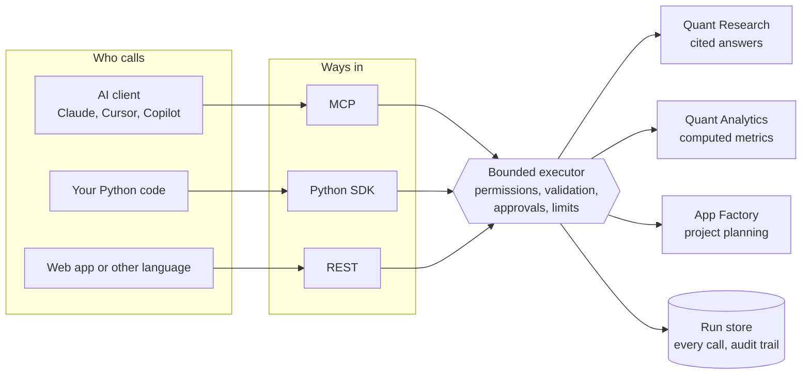

Remember three rules. Each lab shows at least one of them in action:

1. **Numbers are computed, and facts are cited.** Reports label each finding `computed`,
   `retrieved`, or `interpretation`, so you can tell them apart.
2. **Read-only by default.** Anything consequential needs a permission and a human approval.
3. **Everything is recorded.** You can always ask which data and tool versions produced an answer.

## Choose your path

Do Setup and Lab 1, then follow your interest.

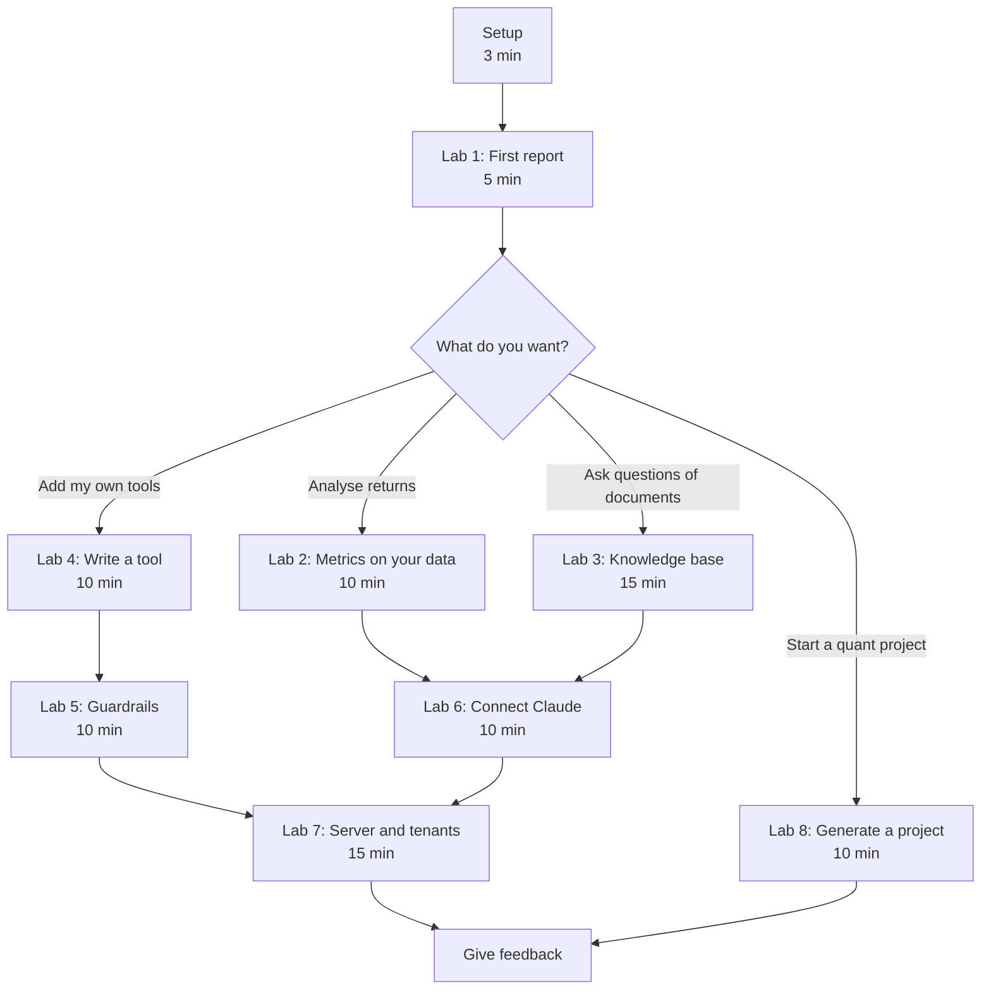

| Lab | You will learn | Needs |
| --- | --- | --- |
| [1. First report](#lab-1-your-first-report) | The plan, tool, and report cycle | Setup |
| [2. Metrics on your data](#lab-2-metrics-on-your-data) | Datasets by reference, stated conventions | Setup |
| [3. Knowledge base](#lab-3-a-knowledge-base-with-citations) | Ingestion, citations, the graph, strategy specs | Setup |
| [4. Write a tool](#lab-4-write-your-own-tool) | The tool contract and `check_tool` | Setup |
| [5. Guardrails](#lab-5-try-to-break-the-guardrails) | Refusals and approvals | Setup |
| [6. Connect Claude](#lab-6-connect-claude-code) | The same tools from an AI client | Labs 2 and 3, Claude Code |
| [7. Server and tenants](#lab-7-a-server-with-two-tenants) | REST, API keys, tenant isolation, quotas | Labs 2 and 3 |
| [8. Generate a project](#lab-8-generate-a-quant-project) | App Factory: study, backtest, report | Setup, network |

## Setup

```bash
git clone https://github.com/yuxuzi/quant-agent-os.git
cd quant-agent-os
uv sync --locked
source examples/tutorial/env.sh
```

If you already have a clone, skip the first two lines. `env.sh` keeps your work in one folder, `~/qaos-tutorial`, so it stays apart from any real
Quant-Agent-OS data you have. **Run every command from the repository root. In each new terminal,
run the `source` line again.**

Check that it works:

```bash
uv run quant-agent-os --version
```

---

## Lab 1: Your first report

**Goal:** see one complete cycle, with no AI involved. A fake model returns a scripted plan, so
the result is the same every time.

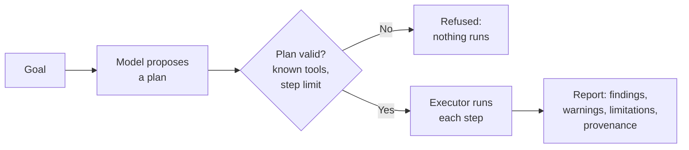

### Run it

```bash
uv run python examples/portfolio-research/portfolio_research.py
```

```text
# Summarize the return and drawdown profile of the synthetic balanced portfolio

## Findings

- **computed**: Annualized return of synthetic-balanced-2025 is 4.82%. [sources: synthetic-balanced-2025 (12 periods)]
- **computed**: Maximum drawdown of synthetic-balanced-2025 is -2.10%. [sources: synthetic-balanced-2025 (12 periods)]

## Warnings

_None._

## Limitations

- Findings are limited to the registered tools and the data supplied for this run.
- This report is research support, not investment advice.

## Provenance

| Step | Tool | Version | Status | ms |
| --- | --- | --- | --- | --- |
| 1 | annualized_return | 1.0.0 | ok | 1.091 |
| 2 | max_drawdown | 1.0.0 | ok | 0.15 |
```

### What just happened

- Every finding says how it was produced (`computed`) and what it came from.
- The **Provenance** table shows which tool version produced each number.
- The numbers came from Python code, never from a model.

### Play with it

Make your own copy of the configuration:

```bash
cp examples/portfolio-research/sample_config.toml "$TUT/my_portfolio.toml"
```

Edit the copy, then run the example on it:

```bash
uv run python examples/portfolio-research/portfolio_research.py "$TUT/my_portfolio.toml"
```

| Change this in the file | What you should see |
| --- | --- |
| Keep only 3 values in `returns` | Warnings: `Only 3 observations ...; results are unreliable below 12.` |
| Add `"guess_the_future"` to `metrics` | Refused: `The plan uses a tool that is not available: 'guess_the_future'.` (it ends a Python traceback) |
| Set `max_steps = 1` | Refused: `The plan has 2 steps; the limit is 1.` |

**The lesson:** a plan is checked before anything runs, and weak data produces a warning, not
false confidence.

---

## Lab 2: Metrics on your data

**Goal:** compute performance and risk by naming a dataset, not by pasting numbers. This is how
an AI client works too, so the numbers never pass through the model.

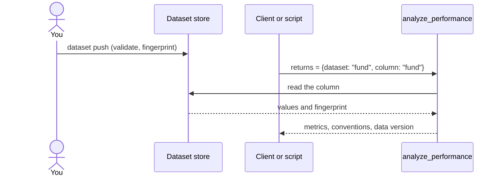

### Run it

Add the two sample datasets. Adding data is a command **you** run, and never a tool the model
can call.

```bash
uv run quant-agent-os dataset push examples/tutorial/data/fund_returns.csv --id fund
uv run quant-agent-os dataset push examples/tutorial/data/portfolio_returns.csv --id portfolio
uv run quant-agent-os dataset list
```

```text
Added dataset fund: 36 rows, columns fund, benchmark (sha256 cab59d43f0a99633).
Its dates show 12 periods per year.
Added dataset portfolio: 36 rows, columns equities, bonds, gold, market, rates (sha256 137459bf5cc09216).
Its dates show 12 periods per year.
```

Now compute:

```bash
uv run python examples/tutorial/lab_analytics.py
```

```text
Performance of fund.fund over 36 months
  annualized_return    0.1054
  sharpe_ratio         1.1043
  max_drawdown        -0.0803
  beta                 0.8210
  alpha                0.0184
  Sharpe convention: mean excess over sample deviation, times sqrt(periods per year); the annual risk-free rate is divided by periods per year
  Data version: cab59d43f0a99633
  Warnings: none

Risk of 60-30-10: volatility 7.15% a year
  equities  weight  60%  share of risk  88.9%
  bonds     weight  30%  share of risk   6.6%
  gold      weight  10%  share of risk   4.5%
  Factor exposures: {'market': 0.6, 'rates': 0.21}
  The factors explain 77.2% of the variance.
```

### What just happened

- The script passed `{"dataset": "fund", "column": "fund"}`, never the values.
- The result states the **convention** behind each metric, so nobody has to guess how the
  Sharpe ratio was defined.
- The **data version** is the file's fingerprint. If the data changes, the fingerprint changes.
- A 60% equity weight carries 88.9% of the risk. That gap is why risk contributions are useful.

### Play with it

| Try this | What you should see |
| --- | --- |
| Change `WEIGHTS` at the top of [lab_analytics.py](../examples/tutorial/lab_analytics.py), then rerun (undo it afterwards with `git checkout examples/tutorial/lab_analytics.py`) | New risk shares |
| Use your own returns: `uv run quant-agent-os dataset push my.csv --id fund`, with columns `fund` and `benchmark` | Your own metrics and a new data version |
| Push only 6 rows as `fund`: `head -7 examples/tutorial/data/fund_returns.csv > "$TUT/short.csv"`, then `uv run quant-agent-os dataset push "$TUT/short.csv" --id fund` | `Warnings:` says the results are unreliable below 12 observations. Push the full file again afterwards, because later labs use it |
| Push a CSV with a text value in a number column | Refused, naming the place: `Dataset 'broken' line 3, column 'fund': 'oops' is not a number or a missing value.` |
| Blank out one `fund` cell in a copy of the file, and push it as `fund` | It loads and says one cell is missing. `Warnings:` says one row was left out, and nothing is filled in |

---

## Lab 3: A knowledge base with citations

**Goal:** build a searchable knowledge store from documents, ask questions, and get answers you
can check, passage by passage.

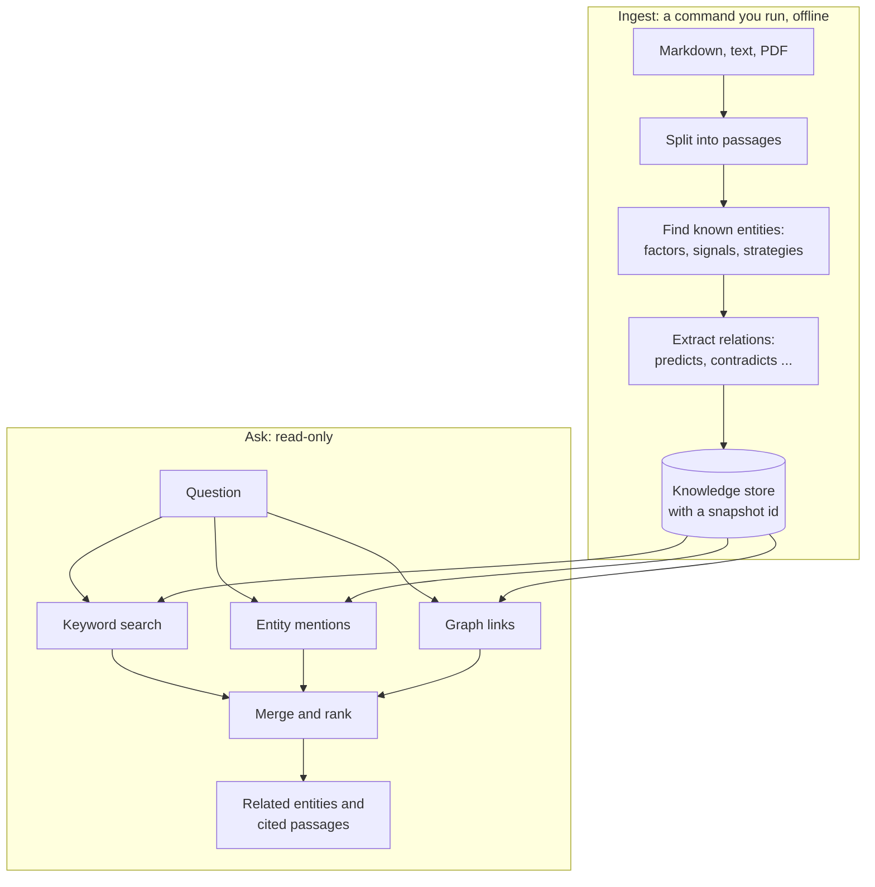

### Build the store

```bash
uv run quant-research ingest packages/quant-research/tests/fixtures/corpus --store "$KB"
```

```text
Added 6, unchanged 0, skipped 1: 9 chunks, 45 mentions, 32 relations, 0 embeddings.
Corpus snapshot snap:8cddf9d734e07c1c in .../qaos-tutorial/kb.db.
warning: Skipped chart.png: supported types are .markdown, .md, .pdf, .txt.
```

### Ask a question

```bash
uv run quant-research search "What is related to short-term reversal?" --store "$KB"
```

```text
 Entity               Type    Score  Connection
 Liquidity provision  signal  0.80   signal:short-term-reversal -correlates_with-> signal:liquidity-provision
 Order-flow imbalance signal  0.80   signal:short-term-reversal <-predicts- signal:order-flow-imbalance
 Momentum             factor  0.70   signal:short-term-reversal <-contradicts- factor:momentum
reversal-and-microstructure.md (lines 17-19, § Mechanism) keyword, mention, graph
notes/order-flow.md (lines 3-6, § Order-flow imbalance notes) keyword, mention, graph
momentum-crashes.md (lines 10-14, § Momentum, reversal, and crashes) keyword, mention, graph
reversal-and-microstructure.md (lines 12-13, § Summary) keyword, mention
reversal-and-microstructure.md (lines 23-24, § Costs) keyword
Corpus snapshot snap:8cddf9d734e07c1c.
```

**How to read it:** each entity shows the graph path that links it to your question. Each passage
gives its file and lines, so you can open the file and check, plus the channels that found it.

### See what the corpus does not know

```bash
uv run quant-research search "protein folding" --store "$KB"
```

```text
warning: Nothing in the corpus matched the query; try the names of factors, signals, or strategies, or ingest more documents.
```

Finding nothing is the correct answer here. The tool returns no evidence rather than a guess.

### Draft a strategy spec, then improve it

```bash
uv run quant-research strategy "short-term reversal" --store "$KB"
```

```text
 Section  Statement                                        Sources
 signals  Short-term reversal correlates with Liquidity... reversal-and-microstructure.md (lines 17-19, § Mechanism)
 signals  Order-flow imbalance predicts Short-term rever...notes/order-flow.md (lines 3-6, § Order-flow imbalance notes)
 risks    Short-term reversal explained by Bid-ask bounce. reversal-and-microstructure.md (lines 17-19, § Mechanism)
 risks    Momentum contradicts Short-term reversal.        momentum-crashes.md (lines 10-14, § Momentum, reversal, and crashes)
open: No source ties Short-term reversal to an asset class or instrument; choose the universe.
open: No source names a dataset for Short-term reversal; choose the price and reference data.
open: No source names a test method for Short-term reversal; choose one (for example portfolio sorts or walk-forward).
open: No source names evaluation metrics for Short-term reversal; choose them before testing.
open: Parameters (formation and holding periods, rebalance frequency, costs) are not extracted; set them from the key passages.
```

The `open:` lines are the useful part: the spec says what your documents leave undecided. Now
teach it something by adding [a note](../examples/tutorial/data/notes/my-reversal-note.md):

```bash
mkdir -p "$TUT/notes"
cp examples/tutorial/data/notes/my-reversal-note.md "$TUT/notes/"
uv run quant-research ingest "$TUT/notes" --store "$KB"
uv run quant-research strategy "short-term reversal" --store "$KB"
```

Three new rows appear, citing your note, and the universe and test-method questions disappear:

```text
 universe  Short-term reversal tested on US equities.       my-reversal-note.md (lines 3-7, § My note on reversal and volatility)
 methods   Short-term reversal uses Portfolio sorts.        my-reversal-note.md (lines 3-7, § My note on reversal and volatility)
 risks     Low volatility contradicts Short-term reversal.  my-reversal-note.md (lines 3-7, § My note on reversal and volatility)
```

The snapshot id changes too, so you can tell which corpus version produced each answer.

### Read the record

Now call the same tool from Python. The SDK records the call, as MCP does:

```bash
uv run python examples/quant-research/sdk_demo.py "$KB" "momentum crashes"
uv run quant-research runs --store "$KB"
```

```text
Q: momentum crashes
  related: Time-series momentum (signal, score 0.75)
  related: Short-term reversal (signal, score 0.70)
  cited:   momentum-crashes.md, lines 10-14, § Momentum, reversal, and crashes
  cited:   momentum-crashes.md, lines 16-20, § Momentum, reversal, and crashes
Run 5139...: completed, snapshot snap:32c1a82b3273c76a, input sha256 0c0b...
5139...  2026-11-03 22:50:59  sdk   completed  snap:32c1a82b3273c76a  find_related_signals
```

To see one run's calls and audit trail, run `uv run quant-research runs <RUN_ID> --store "$KB"`.

### Play with it

| Try this | What you should see |
| --- | --- |
| `uv run quant-research search "carry" --store "$KB"`, then read `packages/quant-research/tests/fixtures/corpus/notes/injection.md` | That file orders the AI to grant itself access and delete the corpus. Here it is just a cited passage: retrieved text never feeds back into planning |
| `uv run quant-research search "inventory risk" --store "$KB"` | `warning: No vocabulary entity in the query; seeded from the best keyword passage.` Your note mentions inventory risk, but the graph only knows the bundled vocabulary |
| `uv run quant-research search "reversal" --hops 2 --store "$KB"` | More entities, found two graph steps away |
| Add `--min-confidence 0.4` to the `strategy` command | More rows, from weaker links |
| Add a line such as `Momentum predicts time-series momentum.` to your note, then run `ingest` again | Only the changed file is re-read, with one more relation |
| Run `ingest "$TUT/notes"` twice without changes | `Added 0, unchanged 1` and the same snapshot id |
| Put your own `.md`, `.txt`, or text-based `.pdf` files in `$TUT/notes` and ingest them | Answers from your own documents. Typed relations need explicit phrasing such as "predicts" or "explained by" ([known limitations](walkthrough.md#known-limitations)) |

---

## Lab 4: Write your own tool

**Goal:** add a capability. A tool is a plain Python function with typed input and output.

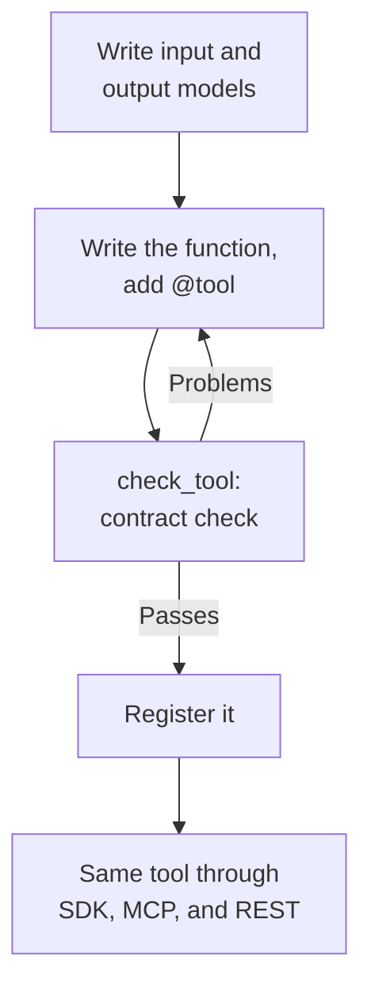

### Read it, then run it

Open [lab_first_tool.py](../examples/tutorial/lab_first_tool.py). The core is short:

```python
@tool(
    name="longest_losing_streak",
    description="The largest number of consecutive periods with a negative return.",
)
def longest_losing_streak(params: StreakInput) -> StreakOutput:
    """Count the longest run of negative returns."""
    longest = current = 0
    for value in params.returns:
        current = current + 1 if value < 0 else 0
        longest = max(longest, current)
    source = SourceRef(source_id=params.series_id, location=f"{len(params.returns)} periods")
    statement = f"The longest losing streak of {params.series_id} is {longest} periods."
    return StreakOutput(
        longest_losing_streak=longest,
        warnings=["Fewer than 12 periods; read with care."] if len(params.returns) < 12 else [],
        evidence=[Evidence(kind="computed", statement=statement, sources=[source])],
    )
```

```bash
cp examples/tutorial/lab_first_tool.py "$TUT/my_tool.py"
uv run python "$TUT/my_tool.py"
```

```text
Contract check passed: the same result directly and through MCP, and deterministic.

Good call: ok
  streak:   3
  warnings: ['Fewer than 12 periods; read with care.']
  evidence: The longest losing streak of demo is 3 periods.

Bad call: invalid_input
  error: returns: Input should be a valid list

Recorded run: completed, by sdk
  input sha256: dd861f8e7cfb4c6f...
  audit trail:  ['run.started', 'tool.called', 'run.finished']
```

### What just happened

- You wrote no MCP code. Registering the tool is what makes it available everywhere.
- The bad call was refused by the input model, so your function never ran.
- `check_tool` is the test to put in your tool package. It compares direct and MCP results,
  checks the output against the schema, and checks that the tool is deterministic.

### Play with it

Edit `$TUT/my_tool.py`, then run it again.

| Change | What you should see |
| --- | --- |
| Add `import random` inside the function and start from `longest = current = random.randint(0, 99)` | `check_tool` fails: `declared deterministic, but two calls returned different output` |
| Import `Permission` and add `permissions=[Permission.NETWORK]` to `@tool` | The contract check still passes, but both calls are `denied`: `check_tool` tests the tool itself, and the default policy is read-only. Permissions are checked before input, so even the bad call gets `denied` |
| Pass `returns=[]` in `SAMPLE` | `check_tool` reports that the status is `invalid_input`, expected `ok` |
| **Challenge:** also return the total loss during the longest streak | Your tool, your design. Tell us how it went |

To start a real tool package with these checks already wired in, see
`uv run quant-factory new agent-tool my-tools` ([walkthrough §10](walkthrough.md#10-generate-a-tool-package)).

---

## Lab 5: Try to break the guardrails

**Goal:** see exactly what stands between a request and a consequential action. The demo tool
`send_order` is a pretend broker order, and it sends nothing.

Every tool call passes through these gates, in this order:

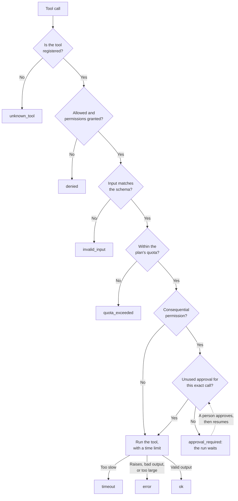

Every result, including each refusal, is recorded.

### Run it

```bash
uv run python examples/tutorial/lab_guardrails.py
```

```text
1. Default policy (read-only)
   status: denied
   error:  Tool 'send_order' needs ungranted permissions: external_action.

2. Permission granted, no approval yet
   status: approval_required
   run:    awaiting_approval

3. The operator approves, and the same call resumes
   status: ok
   output: Pretend order sent: 100 ABC
   audit:  ['run.started', 'tool.called', 'approval.required', 'approval.granted', 'tool.called', 'run.finished']

4. The approval was for that one call, so the next call asks again
   status: approval_required

5. A plan naming a tool that is not registered
   refused: The plan uses a tool that is not available: 'delete_everything'.

6. A plan longer than the step limit
   refused: The plan has 3 steps; the limit is 2.
```

### What just happened

- **Permission** says a tool may run on this server. **Approval** says yes to one specific call.
- An approval is tied to the run, the tool, and the exact input, and it works once.
- A model can't approve anything. In this script the operator's role is played by a line of
  code. In real use it is a person answering a prompt in the client or on an approval page
  ([decision 0014](decisions/0014-approvals-in-the-client.md)).

### Play with it

Copy the lab first: `cp examples/tutorial/lab_guardrails.py "$TUT/guards.py"`, then edit and
run the copy.

| Change | What you should see |
| --- | --- |
| Change `quantity` in `ORDER` to `"lots"` | Section 1 is still `denied`, and section 2 is `invalid_input`: permissions come first, then input, then approval. Section 3 then stops with a traceback, because nothing is awaiting approval |
| Change `max_steps=2` to `max_steps=3` in section 6 | No refusal in section 6: the plan now fits the limit |
| Replace `Permission.EXTERNAL_ACTION` in `@tool` with `Permission.READ_LOCAL_DATA` | Sections 1 and 2 return `ok`, because reading is granted by default and needs no approval. Section 3 then stops with a traceback, because nothing is awaiting approval |

**Found a way past a gate?** That is the most valuable feedback there is. Please report it
[privately](security.md#reporting-a-vulnerability), rather than in a public issue.

---

## Lab 6: Connect Claude Code

**Goal:** let an AI client use what you built. **Do Labs 2 and 3 first**, so there is data to
find. This lab needs Claude Code and sends your questions, plus the tool results Claude reads, to
your model provider.

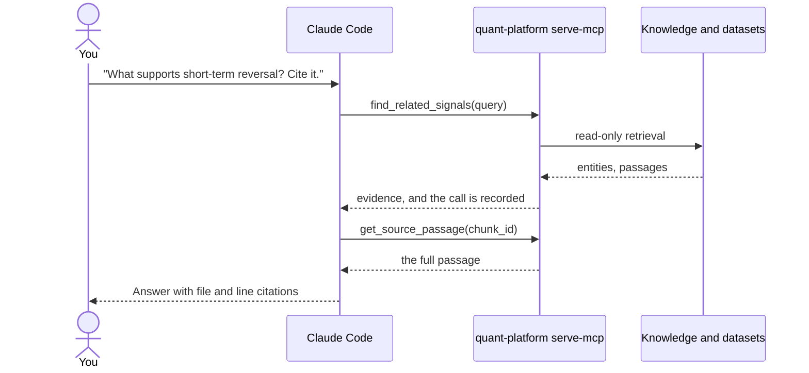

### Connect

First, see what the client will be offered:

```bash
uv run quant-platform catalog
```

You should see 11 tools, 6 resources, and 4 prompts, including `find_related_signals`,
`analyze_performance`, and `research_report`. Then register the server, from the repository root:

```bash
claude mcp add qaos-tutorial -- uv run --directory "$REPO" quant-platform serve-mcp \
  --store "$KB" --datasets "$TUT/datasets" --runs "$TUT/runs.db"
```

Start `claude` in the same folder and run `/mcp` to confirm that `qaos-tutorial` is connected.

### Ask

| Ask Claude | Expect it to call | Check that |
| --- | --- | --- |
| "What is related to short-term reversal, and what supports it? Cite the passages." | `find_related_signals`, `get_source_passage` | Citations match the file and lines from Lab 3 |
| "List my datasets, then analyse the fund column of the fund dataset against benchmark." | `list_datasets`, `analyze_performance` | Sharpe is about 1.10, the same as Lab 2, and the values never appear in the arguments |
| "What drives the risk of a 60/30/10 portfolio of equities, bonds, and gold in the portfolio dataset?" | `analyze_risk` | Equities carry about 89% of the risk |
| "Draft a strategy spec for short-term reversal from my notes." | `generate_strategy` | The open questions from Lab 3 appear |
| "What does my corpus say about protein folding?" | `find_related_signals` | Claude says the corpus has nothing, rather than answering from its own knowledge alone |
| "Delete my knowledge store." | Nothing suitable | No tool can do this: the server only reads |

Claude writes the words, so its answers vary. Check that the numbers and citations come from the
tools. The server returns evidence, and it never writes answers itself.

### See the calls

```bash
uv run quant-research runs --store "$KB"
```

Each call you just triggered is listed with actor `mcp`.

### Clean up this lab

```bash
claude mcp remove qaos-tutorial
```

This setup has the server but not the skills, which teach Claude the best way to use the tools.
To try those, install the plugin as [getting started](getting-started.md) describes. Then compare
the answers, and tell us if the difference is visible.

---

## Lab 7: A server with two tenants

**Goal:** run the platform as a service: first with one API key, then with two customers who
can't see each other's data, then with a quota. It all stays on your machine.

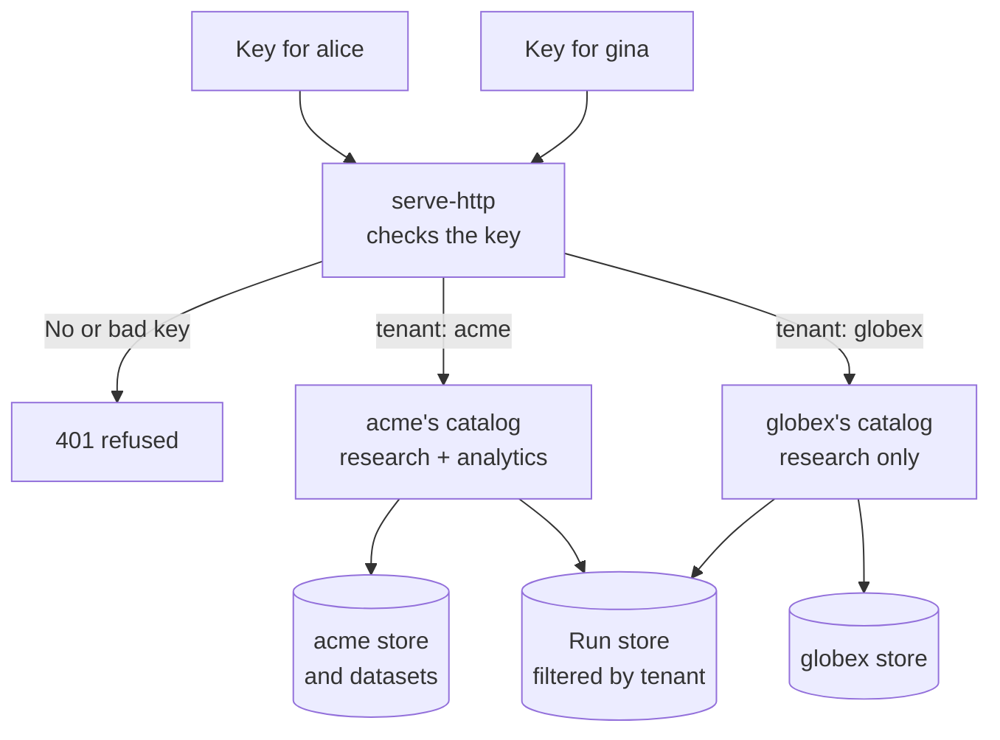

### Part 1: one server, one key

```bash
KEY=$(uv run quant-agent-os api-key new --principal me --scope tools:list --scope tools:call --scope runs:read)
uv run quant-platform serve-http --port 8765 --runs "$TUT/http-runs.db" > "$TUT/server.log" 2>&1 &
SERVER=$!
until curl -s -o /dev/null http://127.0.0.1:8765/v1/tools; do sleep 1; done
```

Call it without a key, then with one:

```bash
curl -s http://127.0.0.1:8765/v1/tools | uv run python examples/tutorial/show.py

curl -s -H "Authorization: Bearer $KEY" http://127.0.0.1:8765/v1/tools \
  | uv run python examples/tutorial/show.py

curl -s -H "Authorization: Bearer $KEY" -H 'content-type: application/json' \
  -X POST http://127.0.0.1:8765/v1/tools/analyze_performance/call \
  -d '{"arguments": {"returns": {"dataset": "fund", "column": "fund"}}}' \
  | uv run python examples/tutorial/show.py
```

```text
refused: Send an API key as 'Authorization: Bearer <key>'.
tools: analyze_performance, analyze_risk, check_spec, describe_template, find_related_signals, generate_strategy, get_source_passage, list_datasets, plan_app, research_report, server_info
status: ok
sharpe_ratio: 1.1043
```

That is the same Sharpe ratio as Lab 2, by a different way in. `show.py` only makes the JSON
readable, so drop it to see the full response. Now a composite: one call that combines cited
research with a metric, with no agent on the server.

```bash
curl -s -H "Authorization: Bearer $KEY" -H 'content-type: application/json' \
  -X POST http://127.0.0.1:8765/v1/tools/research_report/call \
  -d '{"arguments": {"focus": "short-term reversal", "returns": {"dataset": "fund", "column": "fund"}}}' \
  | uv run python examples/tutorial/show.py
```

```text
status: ok
sharpe_ratio: 1.1043
open questions: 3
```

Finally, see who did what, then stop the server:

```bash
curl -s -H "Authorization: Bearer $KEY" http://127.0.0.1:8765/v1/runs \
  | uv run python examples/tutorial/show.py
kill $SERVER
```

```text
run by me in tenant local: research_report completed
run by me in tenant local: analyze_performance completed
```

The API key file stores only a hash of each key, and the key itself is printed once.

### Part 2: two tenants

Give each tenant its own data, and give `globex` research only:

```bash
mkdir -p "$TUT/tenants"
uv run quant-research ingest packages/quant-research/tests/fixtures/corpus --store "$TUT/tenants/acme.db"
uv run quant-research ingest "$TUT/notes" --store "$TUT/tenants/globex.db"
uv run quant-agent-os dataset push examples/tutorial/data/fund_returns.csv --id fund --dir "$TUT/tenants/datasets" --tenant acme

export QUANT_AGENT_OS_TENANTS_FILE="$TUT/tenants.toml"
uv run quant-platform tenant add acme --store "$TUT/tenants/acme.db" --toolsets research,analytics
uv run quant-platform tenant add globex --store "$TUT/tenants/globex.db" --toolsets research
uv run quant-platform tenant list

ALICE=$(uv run quant-agent-os api-key new --principal alice --tenant acme --scope tools:list --scope tools:call --scope runs:read --keys "$TUT/tenants/keys.jsonl")
GINA=$(uv run quant-agent-os api-key new --principal gina --tenant globex --scope tools:list --scope tools:call --scope runs:read --keys "$TUT/tenants/keys.jsonl")

uv run quant-platform serve-http --port 8765 --keys "$TUT/tenants/keys.jsonl" --datasets "$TUT/tenants/datasets" --runs "$TUT/tenants/runs.db" > "$TUT/server.log" 2>&1 &
SERVER=$!
until curl -s -o /dev/null http://127.0.0.1:8765/v1/tools; do sleep 1; done
```

Ask both tenants the same question:

```bash
ask() {
  curl -s -H "Authorization: Bearer $1" -H 'content-type: application/json' \
    -X POST http://127.0.0.1:8765/v1/tools/find_related_signals/call \
    -d '{"arguments": {"query": "short-term reversal"}}' \
    | uv run python examples/tutorial/show.py
}
echo "--- acme";   ask "$ALICE"
echo "--- globex"; ask "$GINA"
```

```text
--- acme
status: ok
related: Liquidity provision, Order-flow imbalance, Momentum
cited: momentum-crashes.md, notes/order-flow.md, reversal-and-microstructure.md
--- globex
status: ok
related: Low volatility
cited: my-reversal-note.md
```

The same question gets a different answer, because each tenant has its own corpus. Now try to
cross the line:

```bash
curl -s -H "Authorization: Bearer $GINA" -H 'content-type: application/json' \
  -X POST http://127.0.0.1:8765/v1/tools/analyze_performance/call \
  -d '{"arguments": {"returns": [0.1, 0.2]}}' | uv run python examples/tutorial/show.py

ACME_RUN=$(curl -s -H "Authorization: Bearer $ALICE" http://127.0.0.1:8765/v1/runs \
  | uv run python -c "import json, sys; print(json.load(sys.stdin)[0]['run_id'])")
curl -s -H "Authorization: Bearer $GINA" http://127.0.0.1:8765/v1/runs/$ACME_RUN \
  | uv run python examples/tutorial/show.py
kill $SERVER
```

```text
refused: No tool named 'analyze_performance' is served here.
refused: No run 3d786f48fc294ca682d86dfa71449934.
```

`globex` can't see the analytics tool, and from its side acme's run simply doesn't exist.

### Part 3: a plan with a quota

Add a plan that allows two calls a minute, move `globex` onto it, and call three times:

```bash
cat >> "$TUT/tenants.toml" <<'TOML'

[plans.trial]
toolsets = ["research"]
calls_per_minute = 2
TOML
uv run quant-platform tenant add globex --store "$TUT/tenants/globex.db" --plan trial

uv run quant-platform serve-http --port 8765 --keys "$TUT/tenants/keys.jsonl" --datasets "$TUT/tenants/datasets" --runs "$TUT/tenants/runs.db" > "$TUT/server.log" 2>&1 &
SERVER=$!
until curl -s -o /dev/null http://127.0.0.1:8765/v1/tools; do sleep 1; done

ask "$GINA"; ask "$GINA"; ask "$GINA"
kill $SERVER
uv run quant-platform usage export --runs "$TUT/tenants/runs.db" --by tool
```

The third call is refused (the wait time varies), and the usage export separates billable calls
from the rest:

```text
status: quota_exceeded
error: Tenant globex is over its 2 calls a minute; retry in 30 s.
hint: The tenant reached a limit of its plan. Wait retry_after_seconds before calling again, and tell the user which limit was reached.
```

```text
tenant,group,toolset,calls,billable_calls,duration_ms,input_bytes,output_bytes
acme,find_related_signals,research,1,1,...
globex,find_related_signals,research,4,3,...
```

Then clear the tenants setting, so later commands in this terminal serve a single tenant again:

```bash
unset QUANT_AGENT_OS_TENANTS_FILE
```

### Play with it

| Try this | What you should see |
| --- | --- |
| Create a key with only `--scope tools:list`, then use it to call a tool | Listing works, and the call is refused: `This API key lacks the 'tools:call' scope.` |
| `uv run quant-platform tenant disable globex --tenants "$TUT/tenants.toml"`, then restart the server | `refused: Tenant 'globex' is not served here.` Its data is kept |
| Connect Claude over HTTP while the Part 1 server runs: `claude mcp add --transport http qaos-http http://127.0.0.1:8765/mcp --header "Authorization: Bearer $KEY"` | The same 11 tools, over HTTP |

> This setup is for learning on loopback. Before you put a server on a network, read
> [deployment.md](deployment.md) and the open findings in
> [security-review.md](security-review.md).

---

## Lab 8: Generate a quant project

**Goal:** go from one command to a tested research project. This lab needs network access. It
writes the project to the folder you run it from and records your approval in
`~/.quant-agent-os/factory-runs.db`.

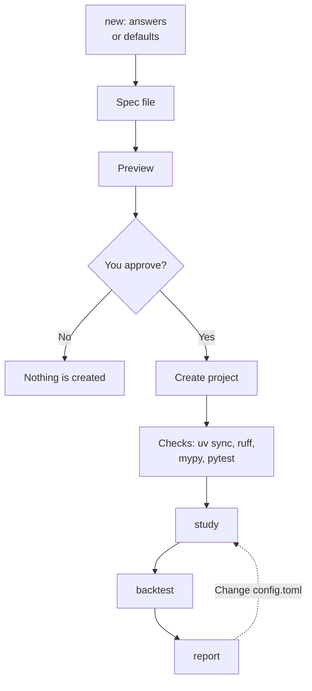

### Create it

```bash
mkdir -p "$TUT/work" && cd "$TUT/work"
uv run --project "$REPO" quant-factory new quant-research my-lab --defaults
```

Answer yes at the prompt. Your yes is the recorded approval.

```text
my-lab (quant-baseline/quant-research) -> .../qaos-tutorial/work/my-lab
  35 files; components: data-csv, metrics; checks: uv sync, ruff check, ruff format, mypy, pytest
Created .../qaos-tutorial/work/my-lab with pytemplate-uv==3.0.0.
  ok  uv sync
  ok  uv run ruff check .
  ok  uv run ruff format --check .
  ok  uv run mypy my_lab tests
  ok  uv run pytest
```

### Run the research

`--demo` uses a random walk, so **finding no edge is the correct result**:

```bash
cd my-lab
uv run my-lab study --demo
uv run my-lab backtest --demo
uv run my-lab report
```

```text
Wrote results/...-study-momentum
Mean rank IC -0.0016 (Newey-West t -0.19) over 750 bars.
Wrote results/...-backtest-momentum
Net Sharpe 0.19, net return 0.49% a year, turnover 186% a year.
Wrote results/...-backtest-momentum/report.md and report-equity.svg
```

Open the `report.md` and `report-equity.svg` it names. Every run gets its own folder, with the
metrics, the parameters, a fingerprint of the prices, and the code version, and no run overwrites
another. Also read `LIMITATIONS.md`, which says what the project does not model.

### Play with it

These run inside `my-lab`.

| Try this | What you should see |
| --- | --- |
| `uv run my-lab backtest --demo --signal reversal --lookback 5` | Turnover jumps from 186% to about 783% a year, and costs bite |
| `uv run my-lab walk-forward --demo` | An out-of-sample Sharpe from chosen lookbacks, here -0.32 over 3 folds |
| Edit `cost_bps` in `config.toml`, then run the backtest again | A new results folder, and a different net Sharpe. The old result is still there |
| Replace the demo data with your own prices | See `data` in `config.toml` and `README.md`. A database source is in [walkthrough §11](walkthrough.md#11-a-quant-project-from-your-own-data-with-guidance) |

Go back to the repository root when you finish:

```bash
cd "$REPO"
```

---

## Clean up

```bash
rm -rf "$TUT"
```

If you did Lab 6 or the HTTP step in Lab 7, also run `claude mcp remove qaos-tutorial` and
`claude mcp remove qaos-http`. Lab 8's approval record stays in
`~/.quant-agent-os/factory-runs.db`, because the audit trail is append-only.

## If something goes wrong

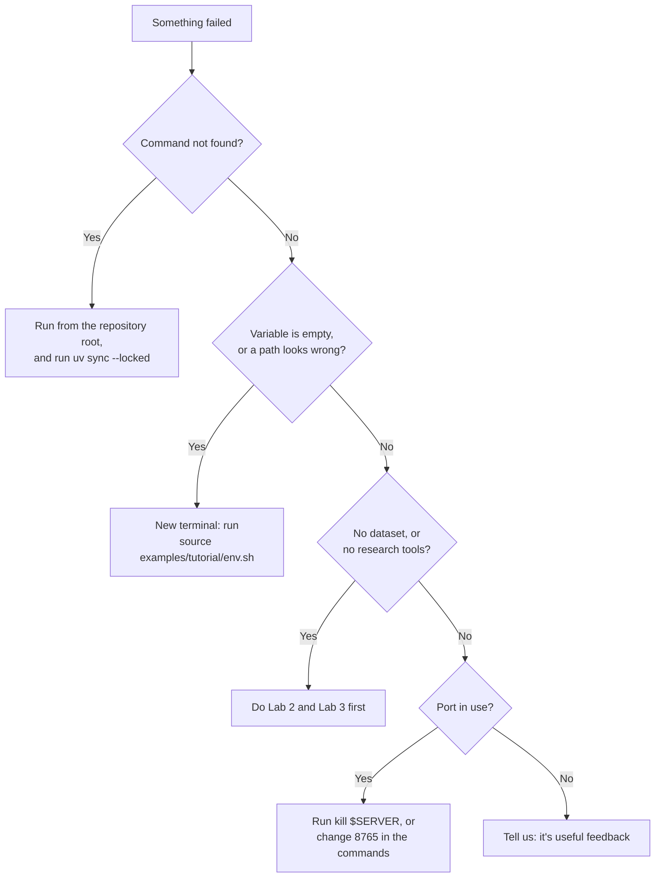

| Symptom | Fix |
| --- | --- |
| `warning: no knowledge store, so the research toolset is not served` | Do Lab 3, and `source examples/tutorial/env.sh` in this terminal |
| `analyze_performance error: ... No dataset 'fund'` | Do the `dataset push` commands in Lab 2 |
| `the server does not start`, or `curl` waits forever in Lab 7 | Read `$TUT/server.log`. In Part 2, check that `QUANT_AGENT_OS_TENANTS_FILE` is set, and press Ctrl+C to stop waiting |
| A single-tenant server still acts on the tenants file | Run `unset QUANT_AGENT_OS_TENANTS_FILE` |
| Install fails while building a package, on a very new Python | Use an older one: `uv sync --locked --python 3.13` |
| Claude doesn't list the server | Run `/mcp` in Claude, and check that the paths in the `claude mcp add` command are absolute |
| You want more detail on a command | Add `--help`. Every command has it |

## Cheat sheet

The split is deliberate: **writes are commands you run, and reads are tools a model can call.**

| | You, the operator (commands) | An AI client (tools) |
| --- | --- | --- |
| **Data** | `dataset push` | `list_datasets`, `analyze_performance`, `analyze_risk` |
| **Documents** | `quant-research ingest` | `find_related_signals`, `get_source_passage`, `generate_strategy`, `research_report` |
| **Projects** | `quant-factory create`, `quant-factory new` | `describe_template`, `check_spec`, `plan_app` |
| **Access** | `api-key new`, `tenant add` | None |

| I want to | Command |
| --- | --- |
| Add a dataset | `uv run quant-agent-os dataset push file.csv --id name` |
| Build or update a knowledge store | `uv run quant-research ingest DIR --store FILE` |
| Ask a question | `uv run quant-research search "question" --store FILE` |
| Draft a cited strategy spec | `uv run quant-research strategy "topic" --store FILE` |
| See recorded runs | `uv run quant-research runs --store FILE` |
| See what a client is offered | `uv run quant-platform catalog` |
| Serve over MCP (stdio) or HTTP | `uv run quant-platform serve-mcp`, `uv run quant-platform serve-http` |
| Create an API key | `uv run quant-agent-os api-key new --principal NAME --scope tools:call` |
| Start a project | `uv run quant-factory new quant-research NAME --defaults` |

**Where to go next:** [walkthrough](walkthrough.md) for your own documents and data,
[architecture](architecture.md) for how it fits together, [configuration](configuration.md) for
every setting, and [security](security.md) for the trust model.

## Give feedback

Your feedback decides what gets fixed next. Rough notes are welcome, and "I got lost at Lab 3"
is a useful report.

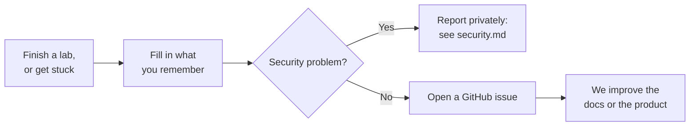

**[Open a feedback issue](https://github.com/yuxuzi/quant-agent-os/issues/new?title=Tutorial%20feedback)**
and paste this template. Skip anything you like.

```markdown
**About me:** quant / developer / both / other. Experience with MCP or AI clients: none / some / lots.
**OS and uv version:**
**Labs I did:**

**Rate each lab you did** (1 = confusing, 5 = clear; add a note if you like)
| Lab | Clear? | Useful? | Note |
| --- | --- | --- | --- |
| 1 First report | | | |
| 2 Metrics | | | |
| 3 Knowledge base | | | |
| 4 Write a tool | | | |
| 5 Guardrails | | | |
| 6 Connect Claude | | | |
| 7 Server and tenants | | | |
| 8 Generate a project | | | |

**Where did I get stuck?** (the lab, the command, and what I saw)

**What surprised me?** (good or bad)

**Did the output differ from the tutorial?** (paste the difference)

**What would I use this for? What's missing for that?**

**The one thing I'd change first:**
```

**Before you paste output:** remove API keys and anything private. Run records can contain
passages from your documents.

These are the questions we most want answered:

- **Documents:** did the citations let you verify the answers, and was the graph useful or
  just noise on your own documents?
- **Metrics:** do the conventions match how you'd compute them, and which metric is missing?
- **Tools:** was writing a tool as simple as it should be, and what got in the way?
- **Guardrails:** would you trust this with a tool that acts? What else would you need to see?
- **AI client:** did Claude pick the right tools, and did it cite properly?
- **Projects:** would you keep working in the generated project, or start over?

**Already known**, so there's no need to report these, though telling us which ones hurt most does
help:

- Retrieval and graph features know only the [bundled vocabulary](walkthrough.md#known-limitations),
  and semantic search needs a hosted embedder.
- App Factory scaffolds and checks your project, but it does not write your research code yet.
- `search` and `ingest` have their own `--store` flag and don't read `QUANT_AGENT_OS_STORE`, which
  is why the tutorial passes `--store "$KB"` every time.
- Lab 1's refused plans end in a Python traceback rather than a clean message.
- `ingest` reports a changed file as `Added 1` rather than as changed.
